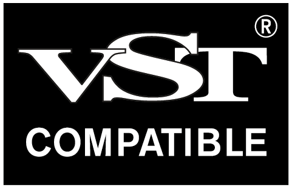

# Changelog

All notable changes to SubForge are listed here. The format follows
[Keep a Changelog](https://keepachangelog.com/en/1.1.0/) and version numbers
follow [Semantic Versioning](https://semver.org/).

When releasing: move the entries under "Unreleased" into a new version
section, raise `project(SubForge VERSION …)` in `CMakeLists.txt` to match and
tag the commit (`vX.Y.Z`).

## [Unreleased]

## [1.0.0] – 2026-10-11

First public release, as free software under the GNU AGPLv3.

### Sound
- Monophonic bass synth with saw, square, pulse, sine and triangle
  waveforms, band-limited to keep aliasing low, plus a sine or square
  sub-oscillator.
- Filter with LP 24, LP 12, BP 12 and diode ladder modes, key tracking and an
  accent sweep.
- Pitch envelope, tempo-synced LFO, click, glide and velocity sensitivity.
- Distortion stage with overdrive, distortion, fuzz and tube amp types.
- 4x oversampling.
- Mod wheel and aftertouch routing.
- Random and mutate buttons for new sounds.
- 89 sound presets, plus user presets you can save, browse and delete in a
  folder of your choice.

### Sequencer
- 16-step sequencer with pitch, accent and slide per step, synced to the
  host's tempo.
- 42 factory patterns, user patterns, copy and paste, and a random pattern
  generator.
- Sound presets and patterns are kept separate, so you can change one without
  the other.
- The sequencer steps can be hidden to make the window smaller.

### Interface
- Vector interface that scales from 75 % to 200 % from the gear menu or by
  dragging the corner, and is shrunk if needed to fit the screen.
- The chosen size is remembered separately for each DAW, since DAWs scale
  plug-in windows differently.
- Live filter response curve, sequencer playhead and selectable accent colour.
- "About SubForge" panel with the third-party notices.

### Formats and platforms
- CLAP and VST®3 plug-ins plus a standalone app, for Linux (x86-64) and
  Windows (x64). No macOS version.
- The Windows build includes the Visual C++ runtime, so nothing extra has to
  be installed.

VST is a registered trademark of Steinberg Media Technologies GmbH.

[Unreleased]: https://github.com/travisdk/SubForge/compare/v1.0.0...HEAD
[1.0.0]: https://github.com/travisdk/SubForge/releases/tag/v1.0.0
