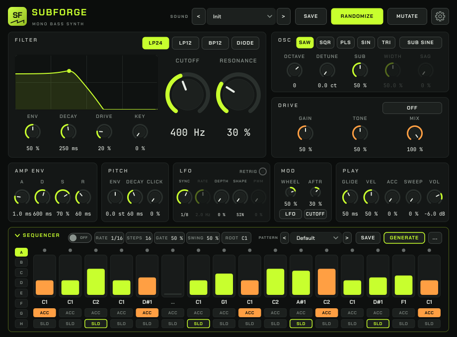
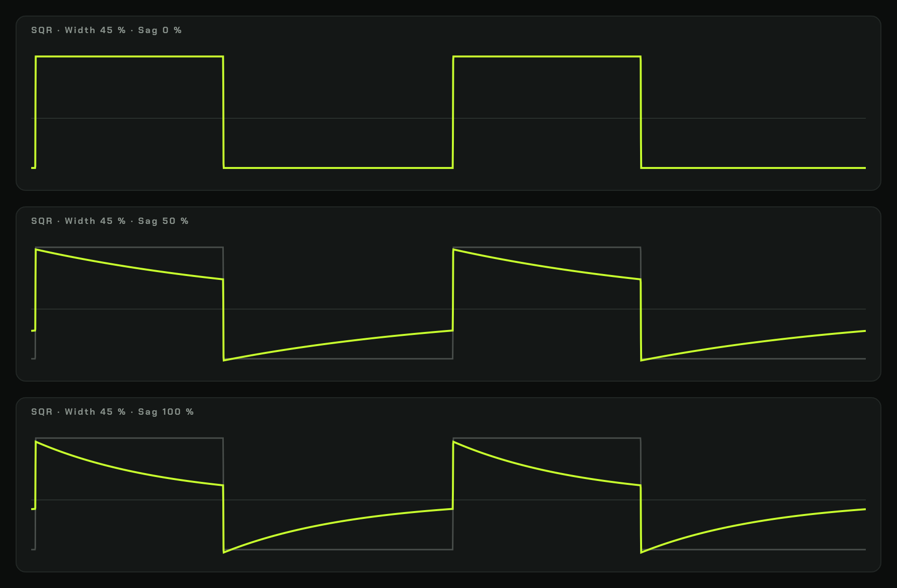

# SubForge

SubForge is a monophonic bass synthesizer with a built-in 16-step sequencer,
for Linux and Windows. It comes as a CLAP and a VST®3 plug-in. Free and open
source.

**Download the latest version:**
[**Linux** (x86-64, .tar.gz)](https://github.com/travisdk/SubForge/releases/latest/download/SubForge-linux-x86_64.tar.gz)
·
[**Windows** (64-bit, .zip)](https://github.com/travisdk/SubForge/releases/latest/download/SubForge-windows-x64.zip)

> **Developed in my spare time.** I work on SubForge when I have the time
> and share it as it is. There is no support and no fixed schedule for
> updates. Pull requests with fixes are welcome, but may
> go unanswered. You are free to fork it and carry it on.

<a href="https://www.steinberg.net/"></a>



**Listen:** six factory sounds, each played by a factory pattern from the
built-in sequencer (124 BPM).

https://github.com/user-attachments/assets/3b5655d9-1d9e-4a71-944f-db04779f6a4d

## Video demo

[](https://youtu.be/k_AJfmAUOYA)

## Features

- Saw, square (with adjustable width), pulse (fixed at 25 %, like a square at
  25 % width), sine and triangle waveforms, band-limited to keep aliasing
  low, plus a sine or square sub-oscillator. The square also has LFO pulse-width
  modulation (PWM) and a Sag control for the classic acid square. Hold Shift
  while dragging a knob to adjust it finely.
- Filter with LP 24, LP 12, BP 12 and diode ladder modes, key tracking and an
  accent sweep.
- Pitch envelope, tempo-synced LFO, glide, click, distortion (overdrive,
  distortion, fuzz, tube amp) and 4x oversampling.
- 16-step sequencer with pitch, accent and slide per step, synced to the
  host's tempo, and eight pattern slots you switch with automation or MIDI
  notes.
- 115 sound presets and 62 patterns, plus your own presets and patterns.
- Vector interface that scales from 75 % to 200 %.

### Square wave shaping

Three controls shape the SQR wave. **Width** sets how long it stays high (50 %
is a perfect square, and a few percent off-centre gives a rawer sound), **PWM**
lets the LFO sweep the width, and **Sag** lets the flat tops and bottoms sag
towards the centre. PLS stays a fixed 25 %, the same as SQR with Width at 25 %.
The picture shows Width 45 % with Sag at 0, 50 and 100 % (grey: the plain
square). `SubForge_WaveShapes` draws it.



See [CHANGELOG.md](CHANGELOG.md) for the full list.

## Playing with the sequencer

While the sequencer runs (sequencer on and your DAW playing), the notes you
play don't sound themselves. They transpose the pattern: the key you hold
becomes the pattern's root note, so holding F2 plays the pattern from F2. If
you hold several keys, the last one pressed wins. Release them all and the
**Root** setting applies again. The new root starts on the next step.

Pitch bend, mod wheel and aftertouch still work as usual. While the DAW is
stopped, or with the sequencer off, notes play SubForge like any synth.

## Switching patterns

The sequencer holds eight patterns in slots A-H, saved with your project.
Click A-H next to the steps to choose the one that plays. In a song, you can
switch slots in two ways:

- **Automation:** automate the **Sequencer Pattern** parameter. Draw it in
  an automation lane, or record it: put the track in latch or write mode and
  click A-H while the song plays. (In touch mode a click is too short to
  stick.) If the parameter is missing from your DAW's list, rescan plug-ins
  or insert SubForge again.
- **MIDI notes:** while the sequencer runs, MIDI note numbers 0-7 choose
  slots A-H. DAWs name these notes differently: C-2 to G-2 in Bitwig and
  Ableton Live, C0 to G0 in FL Studio. Put them in the same MIDI clip as the
  notes that transpose the pattern. Turn this off under **Settings > MIDI
  notes 0-7 choose pattern** if you need those notes to transpose.

Either way, the new slot starts when the playing pattern starts over, so
put the switch on or just before the bar line. If you use both ways, the
latest change wins.

Each slot keeps its own Steps, Rate, Swing and Gate, just as a pattern
file does, so a 7-step pattern in B leaves the 16 steps in A alone. The
controls show and change the slot that plays, and so does automation of
them. A new slot starts on its first step, whatever its length and rate.

Known limitation: Steps, Rate, Swing and Gate follow the active pattern
slot. If you switch slots while your DAW is recording automation, those
four parameters get recorded too. Just delete those lanes afterwards if
you only want the pattern changes.

## Exporting patterns as MIDI

Right-click a slot and choose **Export MIDI** to save it as a MIDI clip, or
use **Export all slots as MIDI** in the pattern menu (**...**). The files go
to the `MIDI` folder next to your pattern folder; **Open MIDI folder** shows
it, and you drag the files from there into your DAW. On Windows you can also
drag a slot straight into your DAW.

A clip is one pass of the pattern, with its accents, slides, gate and swing.
Play it with SubForge's sequencer off, or with another instrument: while the
sequencer runs, incoming notes transpose the pattern instead of playing.

The file is exactly as long as the pattern: Steps × Rate, so 9 steps of
1/16 last nine sixteenths. DAWs such as Bitwig and Ableton Live still round
an imported clip up to a whole bar, so a 9-step clip arrives one bar long
with 7 silent steps at the end. To keep the polyrhythm, set the clip's loop
length (or its end) to the pattern's length before you loop or duplicate it.

How the steps become notes:

- **Slides** hold the note 1/64 beat into the next one, so the notes
  overlap. There is no pitch bend, CC or portamento data. A slide to the
  same note becomes one long note.
- **Slide steps** ignore the gate setting and last the whole step.
- **Velocity** is 89 for normal steps and 127 for accents. SubForge plays
  velocities of 100 and up as accents.

To hear the glide, the receiving synth must be mono with legato or
portamento on. A poly synth plays the overlapping notes as a short chord.

## Download and install

Download the ready-built plug-ins for your system (always the latest
release):

- **Linux** (x86-64):
  [SubForge-linux-x86_64.tar.gz](https://github.com/travisdk/SubForge/releases/latest/download/SubForge-linux-x86_64.tar.gz)
- **Windows** (64-bit):
  [SubForge-windows-x64.zip](https://github.com/travisdk/SubForge/releases/latest/download/SubForge-windows-x64.zip)

Each archive contains `INSTALL.txt` with the install steps. In short, copy
`SubForge.clap` and/or the `SubForge.vst3` folder to your plug-in folder:

| | CLAP | VST3 |
|---|---|---|
| Linux | `~/.clap/` | `~/.vst3/` |
| Windows | `%LOCALAPPDATA%\Programs\Common\CLAP\` | `%LOCALAPPDATA%\Programs\Common\VST3\` |

Then rescan plug-ins in your DAW. SubForge appears as an instrument.

**Tested with:** REAPER and Bitwig Studio 6.1 on Linux Mint, and Ableton
Live 12 and FL Studio 2026 on Windows.

**No macOS version.** I have no Mac to build and test on. The code is plain
JUCE and may well build on macOS, but you are on your own there.

## Building from source

You need CMake 3.22 or newer, a C++17 compiler (GCC or Clang on Linux,
Visual Studio 2022 on Windows) and two SDKs:

- [JUCE](https://github.com/juce-framework/JUCE) **8.0.15**
- [clap-juce-extensions](https://github.com/free-audio/clap-juce-extensions),
  commit `7adee3a`, with its submodules

```sh
mkdir -p ~/SDKs
git clone --depth 1 --branch 8.0.15 https://github.com/juce-framework/JUCE.git ~/SDKs/JUCE-8.0.15
git clone https://github.com/free-audio/clap-juce-extensions.git ~/SDKs/clap-juce-extensions-main
git -C ~/SDKs/clap-juce-extensions-main checkout 7adee3a1bd4684d4caa5601100e364abccff4b4d
git -C ~/SDKs/clap-juce-extensions-main submodule update --init --recursive
```

On Linux, also install the JUCE build dependencies (Debian/Ubuntu names):

```sh
sudo apt install ninja-build libasound2-dev libfreetype-dev libfontconfig1-dev \
  libx11-dev libxcomposite-dev libxcursor-dev libxext-dev libxinerama-dev \
  libxrandr-dev libxrender-dev
```

Then build (on Windows, leave out `-G Ninja` and add `--config Release` to the
build and test commands):

```sh
cmake -S . -B build -G Ninja -DCMAKE_BUILD_TYPE=Release
cmake --build build
ctest --test-dir build                        # unit tests
cmake --build build --target package-linux   # release archive in dist/ (package-windows on Windows)
```

The SDKs are looked for in `~/SDKs` (`%USERPROFILE%\SDKs` on Windows).
Use `-DJUCE_DIR=…` and `-DCLAP_JUCE_EXTENSIONS_DIR=…` to point elsewhere. By
default each build copies the plug-ins into your user plug-in folders; turn
that off with `-DSUBFORGE_INSTALL_AFTER_BUILD=OFF`.

[`docs/ARCHITECTURE.md`](docs/ARCHITECTURE.md) explains how the code is put
together (in Danish).

## Forks and contributions

You are welcome to fork SubForge and change it in your own repository. Only
I can change this repository: pull requests are welcome, but I decide
whether to merge them, and they may go unanswered.

If you share a modified version, the licence requires that you keep the
copyright and licence notices, mark your changes as yours, and publish your
source code under the same licence.

## Licence

Copyright © 2026 Henrik Juhl

SubForge is free software: you can redistribute it and/or modify it under
the terms of the [GNU Affero General Public License, version 3](LICENSE)
(SPDX: `AGPL-3.0-only`). It comes with **no warranty**.

SubForge is built with [JUCE](https://juce.com), used under the AGPLv3. The
other bundled components (CLAP, the VST3 SDK, HarfBuzz, the Chakra Petch and
JetBrains Mono fonts and others) are under permissive licences, listed with
their full texts in [THIRD-PARTY-NOTICES.txt](THIRD-PARTY-NOTICES.txt).

VST is a registered trademark of Steinberg Media Technologies GmbH.
